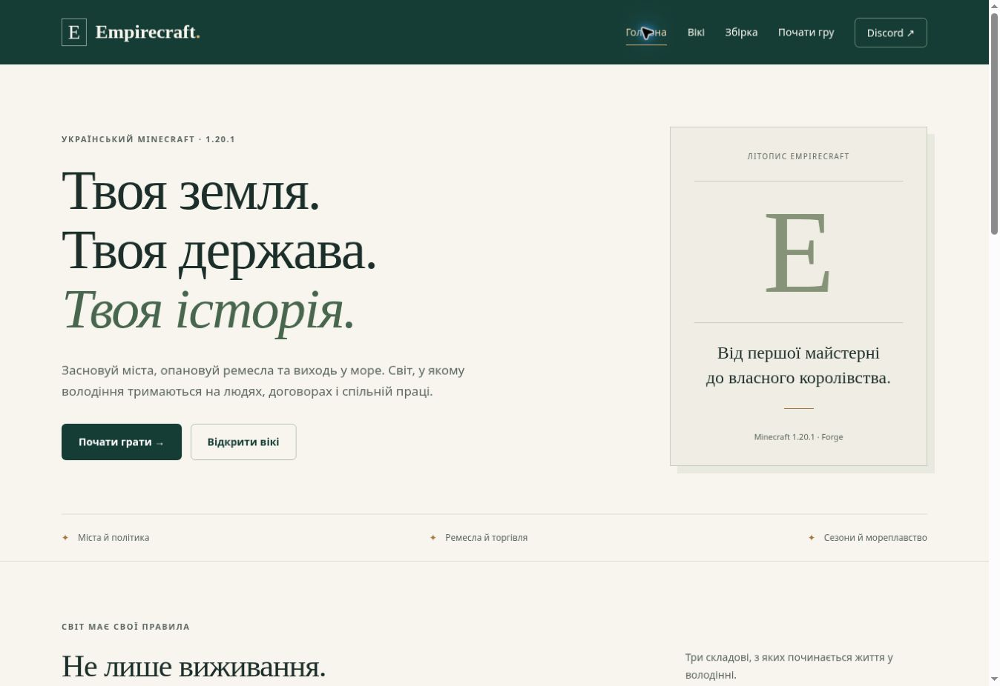

# Empirecraft — сайт і вікі сервера

Український сайт Minecraft-сервера Empirecraft, підготовлений для **Vercel**. Головна, початок гри, 25 статей вікі з пошуком і тематичними фільтрами, каталог модів/плагінів, окремі URL статей та сторінка 404. Зображення й подальше брендове оформлення можна додати пізніше.



Сайт повністю статичний. Потрібен Node.js 22 або новіший; сторонніх npm-залежностей і бази даних немає. HTML генерується під час збірки, JavaScript потрібен лише для пошуку, фільтрів і мобільного меню. Статті доступні й без JavaScript.

## Локально

```sh
npm run build
npm test
npm run dev
```

Локальний сервер: `http://localhost:3000`. Після редагування джерел перезапусти `npm run dev` або повтори збірку. Папка результату — `dist/`, вона не зберігається у Git.

## Vercel

1. У Vercel імпортуй GitHub-репозиторій **2sparta/EmpireCraftSite**.
2. Framework Preset — **Other**, коренева папка — корінь репозиторію.
3. `vercel.json` уже задає **Build Command: `npm run build`**, **Output Directory: `dist`**. Секрети або база даних для запуску не потрібні.
4. Після вибору остаточного домену можна додати `SITE_URL=https://твій-домен` без кінцевого слеша. Це вмикає canonical URL і sitemap.xml. Якщо доступна `VERCEL_PROJECT_PRODUCTION_URL`, її використано автоматично. Без обох значень сайт працює, але не генерує sitemap з вигаданим доменом.
5. Подальші коміти до підключеної гілки можна збирати через інтеграцію Vercel Git.

Немає SPA-перенаправлення всіх URL на головну: кожна стаття має власний статичний HTML, а невідома адреса повинна отримувати 404.

Документація хостингу: [налаштування проєкту Vercel](https://vercel.com/docs/project-configuration) та [підтримка фреймворків](https://vercel.com/docs/frameworks/more-frameworks). Ця робота готує репозиторій; Vercel-проєкт і production deployment окремо не створювалися.

## Що редагувати

| Файл | Призначення |
| --- | --- |
| `content/site.mjs` | Назва, Discord, версія Minecraft/Forge, публічна адреса та посилання на збірку |
| `content/articles.mjs` | Тексти вікі, категорії, джерела та пов’язані статті |
| `content/inventory.json` | Знімок фактичних JAR-файлів клієнта, сервера та плагінів |
| `public/assets/style.css` | Кольори, шрифти, відступи та адаптивне оформлення |
| `public/assets/site.js` | Пошук, фільтри, мобільне меню |
| `scripts/build.mjs` | Шаблони головної, статей, каталогу й метаданих |

Discord зараз **точно такий, як надано**: `https://discord.com/channels/@me`. Це адреса особистих повідомлень, **не запрошення до сервера**. Щоб відвідувачі могли приєднатися до спільноти, заміни `discord` у `content/site.mjs` на справжній invite URL. Публічна IP-адреса та посилання на готову клієнтську збірку залишені порожніми: неперевірених адрес і завантажень сайт не вигадує.

## На чому ґрунтується вікі

Джерело: [2sparta/Empirecraft, commit 0615ee290e54a2ba714c56940da77316a77dfad1](https://github.com/2sparta/Empirecraft/tree/0615ee290e54a2ba714c56940da77316a77dfad1), 25 жовтня 2026. Аналізовано документацію власних модулів, команди Feudal, серверну конфігурацію, скрипт середньовічного Create, маніфест модів і списки JAR. Посилання на конкретні джерела є внизу кожної статті.

Враховано особливості саме Empirecraft: Feudal 1.4, валюти й золото, провізія та пороги голоду, 48-хвилинний календар, World Rules, обмеження Create, ковальська інтеграція, Locks, Claim Guard, JourneyMap, Sails empirecraft.2, Starcatcher і world_europe. Не скопійовано стандартні інструкції до вимкнених механік і не вигадано соціальних правил сервера.

Каталог сформований за фактичними папками `mods`, `server/mods`, `server/plugins`: **99 клієнтських і 102 серверні JAR-файли**, **18 плагінів**; об’єднання списків модів містить 115 різних назв файлів. Клієнтські й серверні бібліотеки не тотожні. Вкладені залежності не рахуються як окремі зовнішні JAR. Конфігураційна папка без JAR не є підтвердженням встановленого плагіна. Маніфест використаний для назв і версій лише за збігу файла, тому застарілі записи не додають відсутні компоненти.

Це знімок репозиторію, а не перевірка процесу на живому хостингу. Після зміни збірки оновлюй відповідні статті, інвентар, дату й джерела. Відвідувачам не показуються статус online, кількість гравців чи обіцянки поточного PvP, які не перевірялися.

## Перевірка

`npm run build` і `npm test`: перевірені HTML-сторінки, заголовки, внутрішні посилання, якорі, файли стилів/скриптів, склад інвентарю, точна Discord-адреса, конфігурація Vercel та реальний контролер пошуку на даних зібраних сторінок (український запит, категорії, порожній результат, скидання, URL-параметри, моди/плагіни). У браузері перевірені головна, пошук і тематичний фільтр вікі, перехід до статті про провізію, фільтр плагінів та пошук Towny у каталозі. Виправлена початкова помилка перевірки шляхів локального dev-сервера. Окрема перевірка на мобільному пристрої та production Vercel не виконувалася; перед публічним запуском переглянь меню й таблиці на телефоні у Vercel Preview.

Для додавання статті збережи унікальний `slug`, наявну категорію, джерела й коректні `related`. Збірка не завантажує приватні серверні файли й не потребує GitHub-токена на Vercel.
